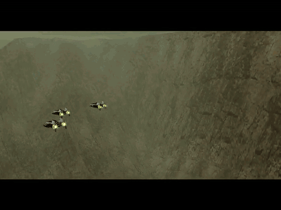
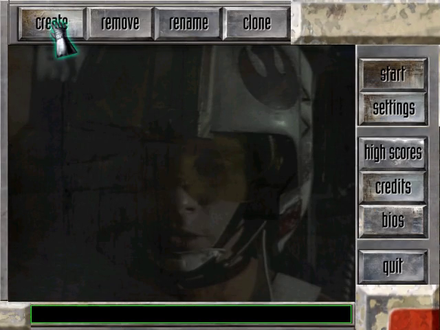
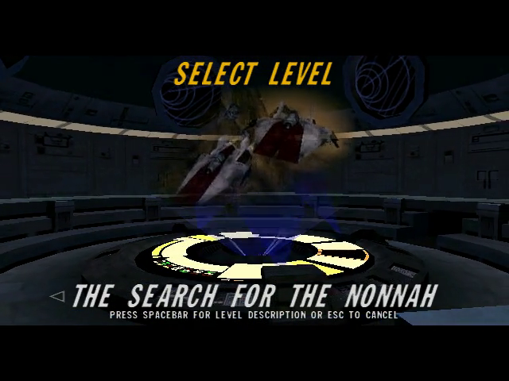
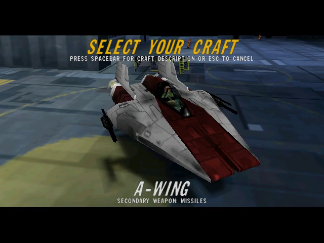
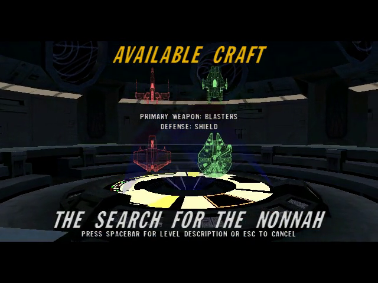
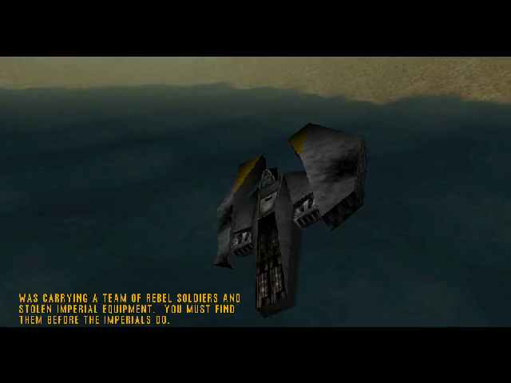
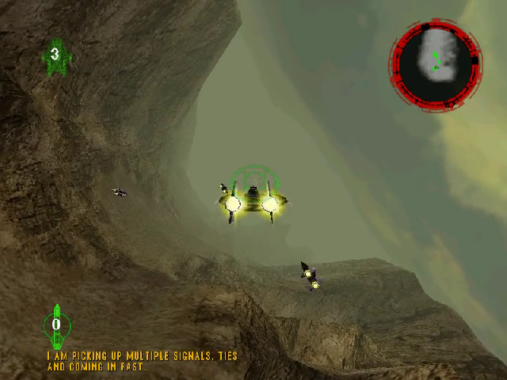

# Rogue Squadron 3D — static recompilation



The 1998 PC release of *Star Wars: Rogue Squadron 3D* (Steam, version 1.3),
recompiled from its x86 machine code to C with
[pcrecomp](https://github.com/sp00nznet/pcrecomp) and run on a 32-bit host
that keeps it in a window, never touches your display mode, and adds an F10
menu for the game's cheats.

It runs Factor 5's own code, recompiled; it is not a remake. **Generated source
is not distributed.** You supply your own copy of the game (Steam), and the
lifted C is generated on your machine.

This is part of the pcrecomp family and follows its shared house style
(layout, CLI, harness, headless mode). Its sibling is
[shadows-recomp](https://github.com/sp00nznet/shadows-recomp).

> **Want to play it?** Download the installer from the
> [latest release](https://github.com/sp00nznet/rogue-squadron-recomp/releases/latest)
> (`Rogue-Squadron-Recomp-Installer-windows-x64.exe`). It finds the game in your
> Steam library and does everything else. See [The installer](#the-installer).

## Status

**v0.1.0-alpha.1. The whole game lifts (13,331 functions, 0 errors), boots
through the intro and the front end, and flies its missions.**

| Part | State |
|---|---|
| SteamStub 3.x removed statically | works (pcrecomp `steamstub.py`) |
| Lift | 13,331 functions, 0 errors, ~3.7 million lines of C |
| Host (`rogue.exe`, 32-bit, pcrecomp `native32`) | 148 imports native, 15 shimmed |
| Display (DirectDraw/Direct3D 6) | never exclusive, never a mode change; the flip chain is emulated and drawn into the window |
| Intro: logos, the trench flyover | runs |
| Front end: pilot roster, settings, level and craft select | runs |
| Missions | The Search for the Nonnah flies: launch, briefing, flight, radar, TIEs |
| Headless (`--headless --record`) | works |
| F10 menu: cheats | Millennium Falcon, TIE Interceptor and bonus missions checked under `--cmd`; the popup itself not yet seen on a screen |
| Borderless window, F11 | written; not yet seen on a screen |
| Gamepad | the game's own DirectInput joystick support; not tried with a real pad |
| Resolution, widescreen | not yet (640x480, the game's default) |
| Playing the later levels through, sound | not tried |

## What's added on top

The game runs as it shipped; everything here sits around it.

- **It stays in a window.** As shipped it takes the screen (exclusive
  DirectDraw, a mode change to 640x480x16). Here it runs borderless fullscreen
  or in a window (F11), scaled with its aspect kept, and your desktop is never
  switched ([docs/bringup.md](docs/bringup.md) 2).
- **An F10 menu** ([docs/menu.md](docs/menu.md)) that holds the game's own
  passcodes on: the Millennium Falcon, the TIE Interceptor, all bonus missions,
  and ace mode. No typing codes into the settings screen.
- **Settings without an administrator.** The game's registry key lives under
  HKCU, so nothing needs elevation.

## Screenshots

From headless runs of the recompiled game.

| | |
|---|---|
|  |  |
|  |  |
|  |  |

## Getting Started

You need *Star Wars: Rogue Squadron 3D* from Steam, installed (Steam app
455910), about 4 GB free, and Windows 10 or 11.

### The installer

Download `Rogue-Squadron-Recomp-Installer-windows-x64.exe` from the
[latest release](https://github.com/sp00nznet/rogue-squadron-recomp/releases/latest)
and run it. (For a build newer than the release, the latest
[installer run](https://github.com/sp00nznet/rogue-squadron-recomp/actions/workflows/installer.yml)
has the same files as artifacts; you need to be signed in to GitHub to
download them.) It finds the game in your Steam library, downloads this repo
and pcrecomp, runs the setup below with a progress bar, and leaves a Play
button. It is [recomp-launcher](https://github.com/sp00nznet/recomp-launcher)
with [`launcher/launcher.json`](launcher/launcher.json). It isn't signed:
Windows SmartScreen asks first (**More info**, **Run anyway**).

### Quick start

1. Download this repo (Code > Download ZIP) and unpack it anywhere.
2. Double-click **`Setup.cmd`**. It checks for Python, the pcrecomp toolkit,
   Visual Studio's C++ tools, CMake and Ninja, and asks before installing
   anything. It finds your Steam install, copies the game into `game\`,
   removes SteamStub, writes the game's settings, and lifts and builds. The
   first time takes 30 to 90 minutes. Everything it does goes to `setup.log`.
3. Double-click **`Rogue Squadron (recomp).cmd`**.

If a step fails, it says what to do in one sentence; run `Setup.cmd` again and
it carries on where it stopped.

### Step by step

Prerequisites: Python 3.10+ (`py -3`), `pip install pefile capstone
cryptography`, Visual Studio 2022 or its Build Tools with "Desktop development
with C++", CMake 3.20+, Ninja, git.

```
git clone https://github.com/sp00nznet/pcrecomp ..\pcrecomp
```

1. Copy your Steam install (the folder with `ROGUE\Rogue Squadron.EXE`) to `game\`.
2. Remove SteamStub:
   ```
   py -3 ..\pcrecomp\tools\drm\steamstub.py "game\ROGUE\Rogue Squadron.EXE" game\ROGUE\Rogue.unwrapped.exe
   SteamStub 3.x: app 455910, header 0x007FF220
     .text 0x00401000+0x1BE000 decrypted (AES-256-CBC); OEP 0x005A2200
   ```
3. Write the game's settings to HKCU: the values are in `tools\setup.ps1`,
   step 4 (Steam writes them to HKLM, which needs an administrator; the host
   reads them from HKCU).
4. Catalog the functions (about 10 minutes):
   ```
   py -3 ..\pcrecomp\tools\disasm\disasm32.py game\ROGUE\Rogue.unwrapped.exe -o work\functions.json
   [*] Functions: 13327  (thunks=6, leaves=4726)
   [*] Byte coverage: 1,794,263 / 1,826,816 (98.2% of code range)
   ```
5. Lift (about 5 minutes):
   ```
   set PCRECOMP=..\pcrecomp
   py -3 run_lift.py --all
     lifted 13331   not-lifted stubs 0   errors 0   no terminator 285
   ```
6. Build: `build.cmd` (with `set CMAKE_ARGS=-DPCRECOMP=..\pcrecomp`).
7. Run: `build\rogue.exe --run`.

Usual trip-ups: `python` opening the Microsoft Store (use `py -3`); a new
`PATH` not seen until you open a new window; a 64-bit compiler environment
(`build.cmd` sets up the x86 one itself).

## Usage

```
build\rogue.exe --run                      play
build\rogue.exe --run --headless --mute --record out.mp4 --watchdog 120
                                           no window, nothing on screen, a video of it
build\rogue.exe --run --headless --mouse 568,107@54 --click 0@56 --key 0x1C@66
                                           scripted input: click Start on the roster, Enter
build\rogue.exe --run --headless --cmd falcon@5
                                           an F10 menu command on a timeline
```

The whole command line and the debug switches: [docs/host.md](docs/host.md).
In the game: **F10** opens the menu, **F11** (or Alt+Enter) switches between
borderless fullscreen and a window.

## Building from source

`py -3 run_lift.py --all` then `build.cmd`, or on the lab farm
`netlab build rogue` (recipe `local/projects/rogue.env` in recomp-netlab).
The generated C lands in `src/recomp/gen/` and is never committed.

## Documentation

- [docs/RECON.md](docs/RECON.md): what is in the Steam install, measured.
- [docs/bringup.md](docs/bringup.md): every wall so far and what got past it.
- [docs/host.md](docs/host.md): the host's parts and command line.
- [docs/menu.md](docs/menu.md): the F10 menu, and the game's passcodes.

## License

MIT for the code in this repository ([LICENSE](LICENSE)): the host, the
display and input layers, the menu, the scripts and the documentation.

*Star Wars: Rogue Squadron 3D* is © Lucasfilm Ltd. / LucasArts, developed by
Factor 5, and is not ours to license. Its executables, data, music and art are
not in this repository and are excluded by `.gitignore`. You need your own copy
of the game; setup copies your Steam install into `game\`.

The unwrapped executable and the lifted C (`src/recomp/gen/`) are made from
the game's own code. They carry the game's terms, not the MIT licence, which
is why they are generated on your machine and never committed.
